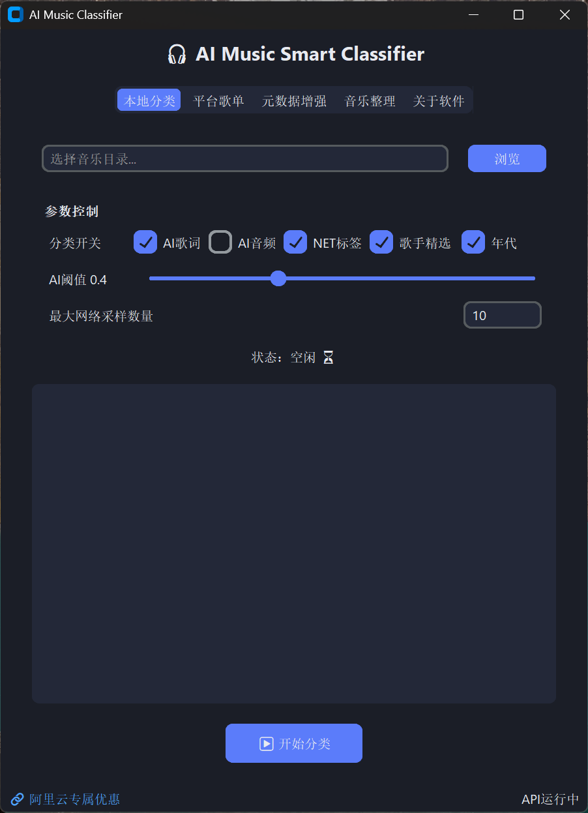
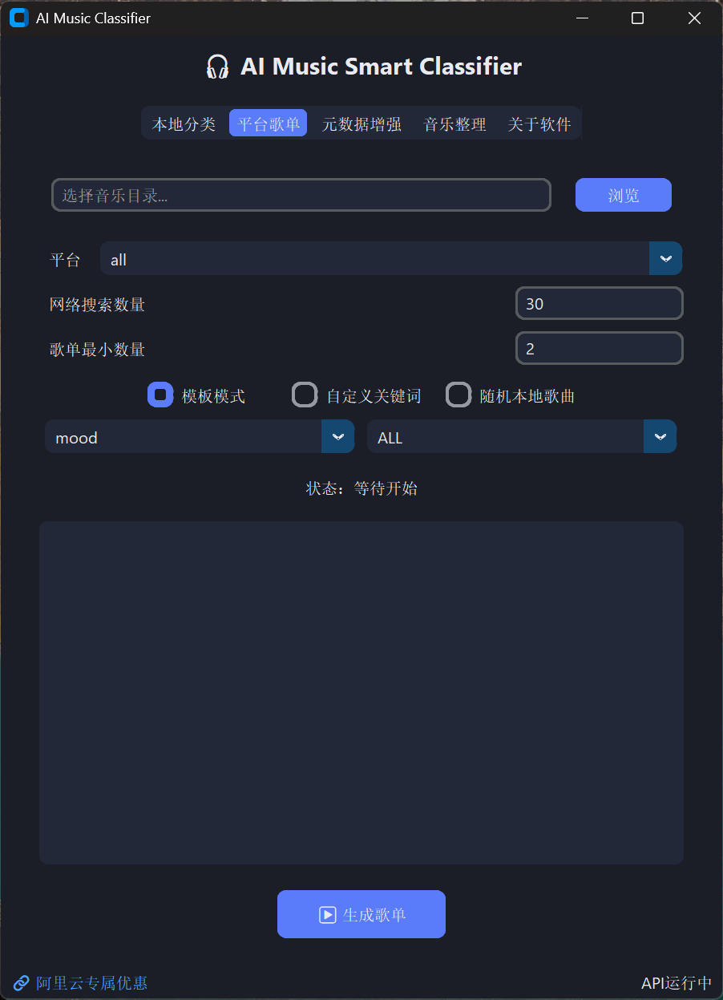
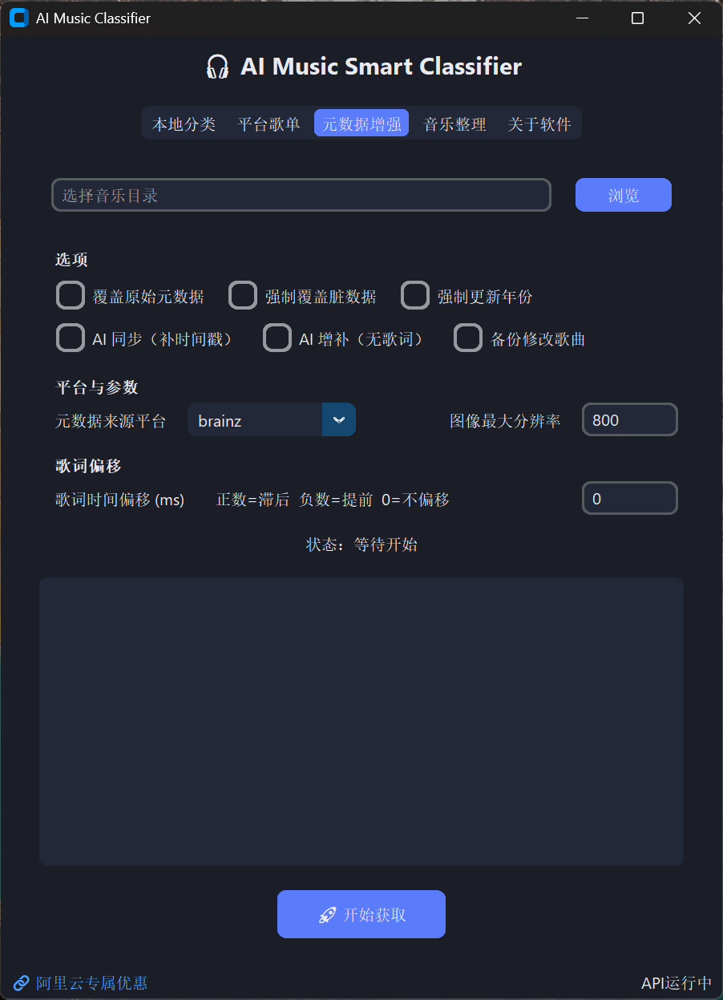
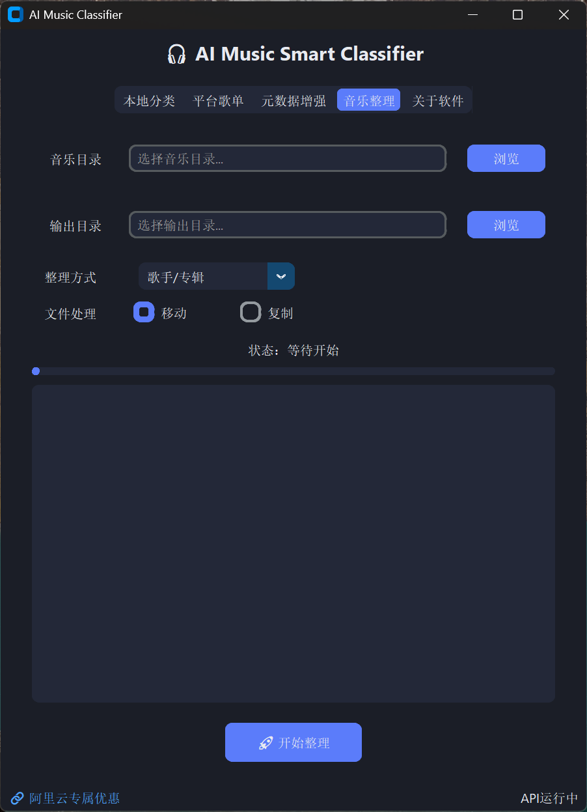

# AI歌单生成器（AI Music Classifier）

> 项目介绍网页：[在线访问](https://home.xuczsnow.cc.cd/app/music_c/index.html)

## 项目简介

> 一个集 **本地音乐管理、AI 智能分类、网络歌单生成、元数据补全、音乐库整理** 于一体的桌面音乐管理工具。
>
> *基于 Python + AI(sentence-transformers + faster-whisper + PANNs) + CustomTkinter + go-music-api，Vibe Coding*

**核心能力**

- 🎵 本地音乐管理：扫描、去重、读取元数据
- 🎧 多类型歌单生成：AI 标签 / 网络热门 / 歌手精选 / 年代精选
- 🤖 AI 智能分类：本地语义模型识别歌曲情绪与主题
- 🏷️ 元数据增强：自动补全标题 / 歌手 / 专辑 / 年份 / 歌词 / 封面，支持 LRC 同步歌词
- 📂 M3U 歌单导出：兼容 Foobar2000 / VLC / Kodi / Jellyfin / EMBY
- 📁 音乐库整理：按 歌手 / 专辑 自动重命名并归类
- 🎨 多主题外观：内置 modern / warm / violet / mono 主题 + 明暗模式，可在"关于"页切换并持久化
- � 启动检查更新：同时检查软件与 go-music-api 的 GitHub 最新版，弹窗提示；API 新版本可一键自动下载更新
- �🔌 CLI / GUI 双模式：GUI 桌面操作，CLI 支持定时任务与脚本化

## 架构

功能分为两层，**core 无 GUI 依赖**，既可被 GUI 调用，也可独立作为 CLI 运行（便于定时任务 / 脚本化）：

```text
├── classify_page.py        # 本地分类页（GUI 壳）   ←  cores/classify_core.py
├── net_playlist_page.py    # 平台歌单页（GUI 壳）   ←  cores/net_playlist_core.py
├── metadata_page.py        # 元数据增强页（GUI 壳） ←  cores/metadata_core.py
├── organize_page.py        # 音乐整理页（GUI 壳）   ←  cores/organize_core.py
├── about_page.py           # 关于页（纯 GUI，含主题设置）
├── gui_music_classifier_ultimate.py   # GUI 总入口
└── cores/                  # 核心逻辑（可独立 CLI 运行 / 单独打包）
    ├── classify_core.py
    ├── audio_classify.py   # PANNs / librosa 音频分类
    ├── pann_tag_map.py     # AudioSet 标签 → 中文标签映射
    ├── net_playlist_core.py
    ├── metadata_core.py
    └── organize_core.py
```

依赖的公共模块位于 `script/`：

```text
└── script/
    ├── common/    # logger、cache、rate_limiter
    ├── music/     # load_music、music_fetcher、asr_align、playlist_service …
    ├── services/  # go-music-api 启停
    └── ui/        # 主题、布局原语（widget_factory）
```

## 安装与运行

**环境要求**：Python 3.10+（推荐 3.14）、Windows。

```bash
# 1. 安装依赖
pip install -r requirements.txt

# 2. 启动 GUI（自动拉起本地 go-music-api）
python gui_music_classifier_ultimate.py
```

> 首次启用 **AI 同步 / 增补** 需要 ASR 模型：
> - 离线：将模型放到 `models/faster-whisper-small/`（代码优先读本地）
> - 联网：缺失时首次运行自动下载到 `models/faster-whisper-small/`（需安装 `huggingface_hub`）
>
> **AI 文本分类**优先使用本地 `models/models--sentence-transformers--all-MiniLM-L6-v2/`；模型缺失时，首次使用会从 Hugging Face 自动下载到该目录（需联网）。
>
> 首次启用 **AI 音频分类** 时，缺少 PANNs 权重会从 Hugging Face 自动下载到 `models/panns_Cnn14/`（需联网并安装 `huggingface_hub`）；也可提前离线放置 `model.safetensors` 和 `tags.txt`。
> 下载或加载失败时自动回退 `librosa`，仍可运行但精度较低；模型下载后推理在本地完成。

> ⚠️ **打包说明**：自 **v1.2.0** 起不再提供打包文件（`*.spec` / InnoSetup 安装器），
> 请以上述**源码方式**运行；历史打包脚本已移至 `backup/` 仅供存档。

### 主要依赖

| 依赖 | 用途 |
| --- | --- |
| `customtkinter` | GUI |
| `sentence-transformers` | 本地语义分类（MiniLM） |
| `faster-whisper` | 歌词 ASR 对齐 / 增补（需 `av==18.1.0`） |
| `librosa` | AI 音频分类的轻量回退特征 |
| `torchlibrosa` | PANNs Cnn14 音频分类（需 `models/panns_Cnn14/`） |
| `scikit-learn` | 余弦相似度 |
| `mutagen` | 读写 FLAC / MP3 标签与封面 |
| `musicbrainzngs` + `requests` | 在线元数据 / 歌词 |
| `go-music-api` | 本地多平台音乐接口（`bin/` 下随附，自动启停） |

## CLI 运行

每个 page 与 core 都支持 **CLI / GUI 双模式**：带参数走 CLI，无参数走 GUI。

| 功能 | CLI 示例 |
| --- | --- |
| 本地分类 | `python classify_page.py <音乐目录> --no-net --ai-threshold 0.4` |
| 平台歌单 | `python net_playlist_page.py <音乐目录> --mode custom --keyword "失恋歌"` |
| 元数据增强 | `python metadata_page.py <音乐目录> --plat brainz --ai-sync --overwrite-dirty` |
| 音乐整理 | `python organize_page.py <输入> <输出> --mode 歌手/专辑 --op move` |

> 直接调 core 也可：`python cores/organize_core.py <输入> <输出> --op copy`。
> 任意命令加 `--help` 查看完整参数。


## 🎧 本地分类

### 页面简介

- 功能选择：选择启用的功能，主要功能介绍见下文各子章节
- AI阈值：配置 AI 匹配的阈值，阈值越大，匹配越精确，匹配到的歌曲会变少
- 网络搜索量：网络歌单采样数据量

### 功能简介

本地分类页面用于扫描本地音乐库，通过 AI 标签分析、歌词分析、规则匹配以及网络辅助分类，为歌曲自动生成标签和主题歌单。

### 📂 音乐库扫描

自动递归扫描指定目录下的音乐文件，并根据音质去重，目前优先选择flac文件：

- MP3
- FLAC

自动读取：

- 歌曲名称
- 歌手
- 专辑
- 年份
- 歌词
- 时长

### 🤖 AI 智能分类

- **AI 文本分类**：基于语义模型（`sentence-transformers`）分析歌曲标题/歌手/歌词，自动识别情绪或主题标签
- **AI 音频分类**（可选）：基于 PANNs Cnn14 直接分析音频（波形/频谱），识别情绪/流派/声音事件，**无歌词、纯音乐也能分类**；PANNs 权重缺失时自动回退轻量 `librosa`

```text
💔_失恋; 💔_孤独; 😢_悲伤; 😌_治愈; 😊_开心; 🔥_热血; 😎_酷; 🌙_夜晚; 📖_学习; 🚗_车载; 🏃_运动; 🛌_睡眠; 🎉_派对; 🎓_毕业; 💍_爱情; 📼_回忆; 🌌_理想; 🧳_成长; 🌙_夜晚; 📖_学习; 🌿_轻松; 🔥_热血; 🌈_青春
```

> 页面提供「AI歌词」/「AI音频」两个独立开关：AI 歌词对**有**歌词的歌曲做语义+音频分类；AI 音频对**全部**歌曲（含无歌词）做音频分类。

### 👨‍🎤 歌手精选

自动生成歌手精选分类歌单，根据权重和命中率排序。

### 📅 年代分类

自动生成年代分类歌单，根据权重和命中率排序。

### 🎼 M3U 歌单导出

自动生成 m3u 格式歌单，具体格式如下：

```
#EXTM3U
#PLAYLIST:NET_🌈_青春
#EXTALB:在我心里有个你
#EXTART:周传雄
#EXTINF:293,周传雄 - 关不上的窗
<音乐目录>\关不上的窗 - 周传雄.flac
#EXTALB:最伟大的作品
#EXTART:周杰伦
#EXTINF:244,周杰伦 - 最伟大的作品
<音乐目录>\周杰伦\最伟大的作品 - 周杰伦.flac
```

兼容：

- Foobar2000
- VLC
- Kodi
- Jellyfin
- EMBY

## 🌐 平台歌单

### 页面简介

- 网络平台选择：只选择相应平台的歌单
- 网络搜索数量：每一次搜索匹配的网络歌单数量
- 歌单最小数量：本地匹配到的歌曲小于该数量时不生成歌单
- 模式选择：
  - 模板模式：预设关键词搜索
  - 自定义关键词：自定义关键词搜索
  - 随机本地歌曲：随机选择本地歌曲搜索

### 功能简介

利用网络音乐平台热门歌单与本地音乐库进行匹配，快速生成符合网络歌单，匹配本地歌曲。

### 支持平台

| 平台       | Source   |
| ---------- | -------- |
| 网易云音乐 | netease  |
| QQ 音乐    | qq       |
| 酷狗音乐   | kugou    |
| 酷我音乐   | kuwo     |
| 咪咕音乐   | migu     |
| 千千音乐   | qianqian |
| 汽水音乐   | soda     |
| 5sing      | fivesing |
| Jamendo    | jamendo  |
| JOOX       | joox     |

*基于 go-music-api 集成*


### 主要功能

- 网络歌单，本地匹配
- 歌单封面下载
    - 自动获取歌单封面
    - 自动保存封面图片

## 🏷️ 元数据增强

### 页面简介

- 选择是否覆盖源文件中的数据，选择后会重写元数据
- 选择元数据来源平台（*歌曲年份信息统一来自netease*）
- 图像最大分辨率，将大于该分辨率的图片压缩为当前分辨率，以方便不同设备的支持
- **AI 同步（对齐歌词时间戳）**：有网络同步歌词时，用本地 ASR 校验前几句是否对齐，对齐则采用网络 LRC，否则用 ASR 全曲生成 LRC
- **AI 增补（无歌词时生成）**：对没有歌词的歌曲，用本地 ASR（faster-whisper）识别生成同步歌词 LRC
- **AI 对齐（无时间戳补戳）**：歌词非空但无 `[m:ss]` 时间戳时，ASR 逐行对齐补时间戳，**保留原歌词字句**
- **歌词偏移（ms）**：正=滞后、负=提前；单独开启时也能对已有歌词做时间偏移

** 如果原始音乐没有元数据，则文件名必须为`歌手 - 歌曲名`格式

### 功能简介

自动从网络平台获取歌曲信息，并写回本地音频文件，方便不同平台音乐库的创建。

### 支持写入内容

- 基础信息：

```text
标题
歌手
专辑
发布日期
```

- 歌词

自动获取歌词并写入标签，播放器可直接读取嵌入歌词。勾选「AI 同步 / AI 增补」时写入带时间戳的同步歌词（LRC），播放器可逐行高亮。

- 专辑封面

自动下载专辑封面并写入标签。


### 覆盖策略

- 补全缺失项（推荐）：已有数据保留，缺失数据补全
- 强制覆盖：全部重新写入


## 📁 音乐整理

### 页面简介

- 选择输出目录
- 整理格式：歌手、专辑、歌手/专辑
- 文件处理：移动或者复制到新文件夹

### 功能简介

一键整理本地音乐库目录结构，将混乱的音乐文件自动重命名为`歌手 - 歌曲名`归类到对应目录中。

- 整理前

```text
Music

├── track001.mp3
├── song.flac
├── 周杰伦 稻香.mp3
├── unknown.*lac
```

- 整理后

```text
Music

├── 周杰伦
│   └── 魔杰座
│       └── 稻香.flac
│
├── 陈奕迅
│   └── U87
│       └── 浮夸.flac
```


### 自动重命名

将混乱的音乐文件自动重命名为`歌手 - 歌曲名`

## GUI界面

*基于 CustomTkinter 开发，内置 modern / warm / violet / mono 四种配色主题与明/暗模式，可在「关于」页切换并自动记忆。*

### AI歌曲分类



### 网络歌单匹配



### 歌曲元数据增强



### 音乐文件整理



## 目录结构

```text
MusicC/
├── gui_music_classifier_ultimate.py   # GUI 总入口
├── *_page.py                          # 各功能页面（GUI 壳 + CLI/GUI 双模式入口）
├── about_page.py                      # 关于页（主题设置）
├── cores/                             # 核心逻辑（无 GUI 依赖，可单独 CLI / 打包）
├── script/                            # 公共模块（common / music / services / ui）
├── assets/                            # covers/ 歌单封面、themes/ 主题配色
├── docs/screenshots/                  # README 界面截图
├── models/                            # 本地 AI 模型（faster-whisper 等）
├── bin/go-music-api_windows_amd64/    # 本地多平台音乐接口
├── cahce/                             # 运行时缓存（歌单 / 元数据 / ASR）
└── release_note/                      # 各版本发布说明
```

## License

Copyright © 2026 Zong Xu

Licensed under the Apache License, Version 2.0.

You may obtain a copy of the License at:

https://www.apache.org/licenses/LICENSE-2.0

