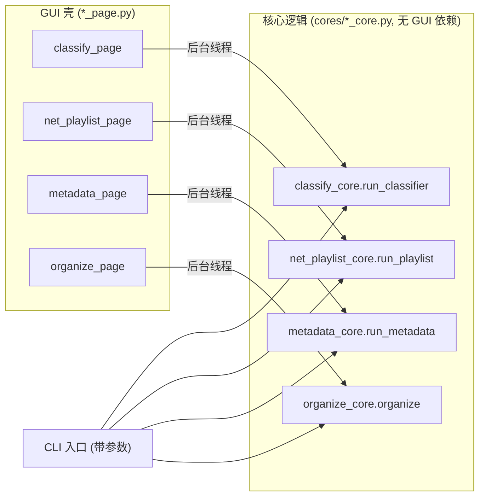
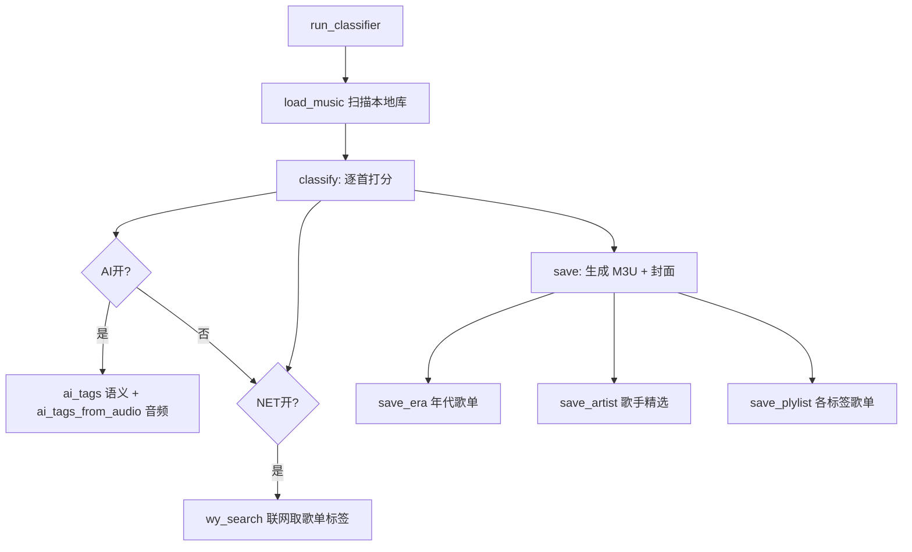
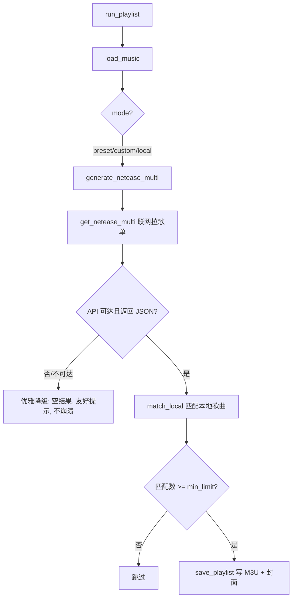
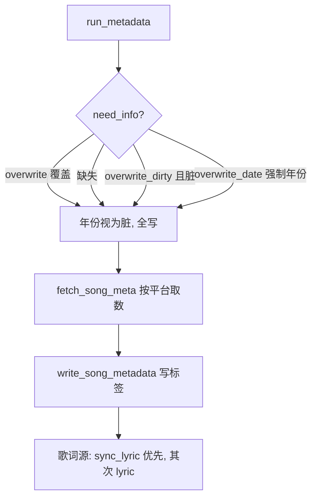
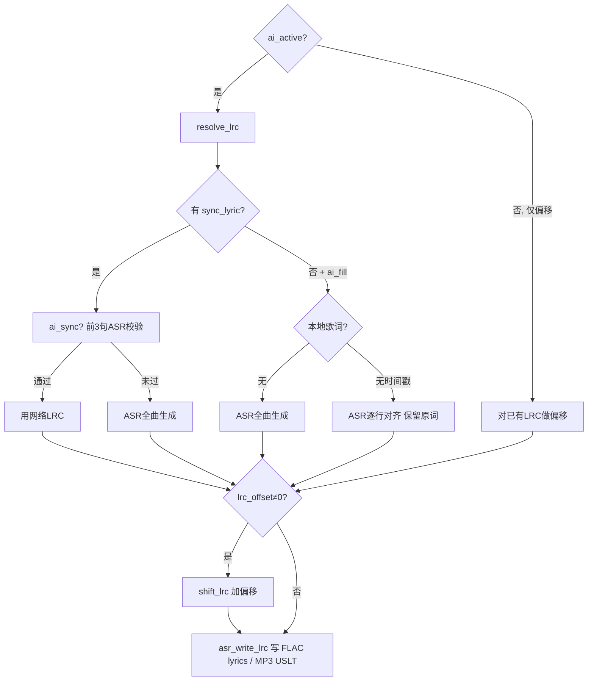
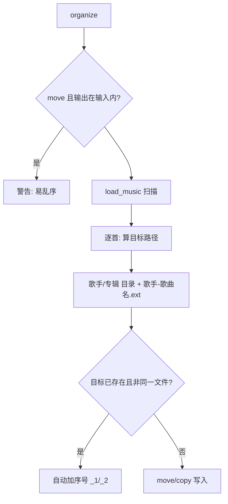

# 四大功能页面逻辑梳理

> 本项目采用 **"薄 GUI 壳（`*_page.py`） + 核心逻辑（`cores/*_core.py`）"** 分层，
> 每个页面支持 **CLI / GUI 双模式**（带参数走 CLI，无参数走 GUI）。
> 本文梳理四个功能页面的调用链路、数据流与关键开关，并附 Mermaid 框图。

## 通用架构

### 线程安全约定
所有页面的后台任务都在**子线程**调用 core；core 通过 `log`（线程安全的
`AppLogger` 队列）回传日志。**子线程不得直接操作 Tk widget**（含 `.after`/`.configure`），
进度/状态由主线程 `widget.after` 轮询刷新线程安全变量（`threading.Event` / dict）。

> 四个页面（classify / net_playlist / metadata / organize）均已按此约定实现：
> 子线程只写 `threading.Event` / 进度 dict，UI 刷新统一在主线程 `after` 回调完成。

---

## 1. 本地分类（`classify_page` → `classify_core.run_classifier`）

把本地音乐按 标签/歌手/年代 分类，生成 M3U 歌单 + 封面。

### 开关
| 开关 | 说明 |
|------|------|
| AI歌词 | 语义（sentence-transformers）对标题/歌手/歌词打 AI 情绪标签 |
| AI音频 | PANNs Cnn14（缺失回退 librosa）对波形打标签，纯音乐也可 |
| NET标签 | 联网搜歌单取网络标签（go-music-api，歌单搜索无需登录态） |
| 歌手精选 / 年代 | 按歌手 / 按年份生成精选歌单 |
| AI阈值 / 最大网络采样 | 标签置信度阈值 / 联网采样上限 |

### 流程

- 产物写入 `<音乐目录>/AI分类歌单/<标签>/`（M3U + cover）。
- 空/0 年份不生成空年代歌单（已修）。

---

## 2. 平台歌单（`net_playlist_page` → `net_playlist_core.run_playlist`）

从 go-music-api 拉取歌单，匹配本地歌曲，生成 M3U。

### 三种模式
| 模式 | 关键词来源 |
|------|-----------|
| preset 模板 | `TAG_DEFINITIONS[group][tag]` 预置词 |
| custom 自定义 | 用户输入关键词 |
| local 随机 | 随机取本地歌曲作为关键词 |

### 流程

- 歌单搜索**不依赖登录态**（公开搜索能力）。当 API 不可达或返回非 JSON（如网关拦截）时，
  代码按 `Content-Type` 判定后打友好 WARNING 并返回空，**不崩溃**（健壮性保留）。

---

## 3. 元数据增强（`metadata_page` → `metadata_core.run_metadata`）

补全/重写 FLAC·MP3 标签（标题/歌手/专辑/年份/封面/歌词），含 AI 歌词处理。
**两阶段**设计：

### 阶段 A：歌曲信息增补（规范 1-4）

- **覆盖** → 所有信息重写；**否则** → 只写缺失/脏字段。
- **年份**：`overwrite_date` 时所有年份视为脏、强制更新。
- **歌词**：统一优先用网络 `sync_lyric`（带时间戳），其次纯文本 `lyric`。

### 阶段 B：歌词处理（规范 5，对所有歌曲）
触发条件：`ai_sync or ai_fill or lrc_offset≠0`。

- **5.1 AI同步**：对 `sync_lyric` 前 3 句 ASR 校验，通过用网络、不过用 ASR。
- **5.1 AI增补**：无歌词→ASR 全曲；无时间戳→ASR 逐行补戳（保留原词）。
- **5.2 偏移**：`lrc_offset` 对所有处理歌曲的 LRC 加偏移（单独开也能对已有歌词生效）。

---

## 4. 音乐整理（`organize_page` → `organize_core.organize`）

按 `歌手/专辑` 结构重排文件，移动/复制。

### 参数
| 参数 | 取值 |
|------|------|
| 整理方式 | `歌手/专辑`、`歌手`、`专辑` |
| 文件处理 | `move`、`copy` |

### 流程

- 文件名规范为 `歌手 - 歌曲名.ext`。
- 目标同名自动加序号，避免覆盖（已修）。
- 输出目录位于音乐目录内部时给出警告（move 易乱序）。

---

## 页面 ↔ 核心函数速查

| 页面 | CLI 示例 | 核心函数 |
|------|---------|---------|
| 本地分类 | `python classify_page.py <dir> --no-net --audio` | `run_classifier` |
| 平台歌单 | `python net_playlist_page.py <dir> --mode custom --keyword "失恋"` | `run_playlist` |
| 元数据 | `python metadata_page.py <dir> --plat brainz --ai-fill --lrc-offset -200` | `run_metadata` |
| 音乐整理 | `python organize_page.py <in> <out> --mode 歌手/专辑 --op copy` | `organize` |
